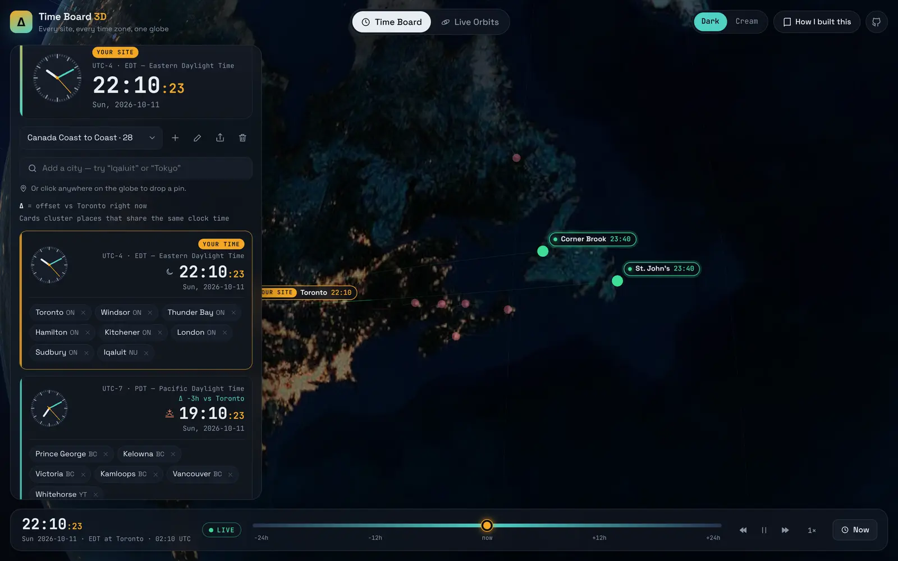

# Time Board 3D

**World clocks for every site you work with, on a live 3D globe. Plus every tracked satellite overhead.**

**[▶ Open the app](https://deven-chandel.github.io/Project-Delta/)** · **[How I built it](https://deven-chandel.github.io/Project-Delta/about.html)**


Time Board 3D is the second version of a single-file *Canada Time Board* I wrote to look up time zones for report
timestamps. It keeps v1's core idea, one card per clock time with each card's **Δ** against *your site*, and puts it on
a WebGL Earth with a real-time day/night terminator, a meeting planner and shareable groups. A bonus **Live Orbits** mode
shows 10,000+ real satellites on the same clock.

Built by **Deven Chandel** by directing [Claude Code](https://claude.com/claude-code). The
[case study](https://deven-chandel.github.io/Project-Delta/about.html) covers the decisions, architecture and the bugs
caught along the way.

## Features

| | |
|---|---|
| **Offset cards** | Places that share a clock time cluster into one card with an analog clock, Δ vs your site, and day/night state. DST regrouping happens automatically. |
| **Your site** | Detected from your browser's time zone. Pin any place as the reference and every Δ updates. |
| **Groups** | Your 28 Canadian places as the demo, plus a global team. Search 2,360 cities, or click anywhere on the globe to drop a pin (ocean time zones included). |
| **Meeting planner** | Working hours for every card on your timeline, with the shared window highlighted. Click to jump the globe to that moment. |
| **Time travel** | Scrub ±24 h, or run from −1000× to 1000×. Sunlight, clocks and satellites stay in sync. |
| **Share links** | A group is encoded into the URL fragment. No accounts, no server. |
| **Live Orbits** | Space stations, Starlink, GPS, geostationary, weather and science satellites, propagated with SGP4. Shows orbit rings, the next passes over your site, and a live sky plot. |
| **Themes** | v1's Dark and Cream themes, colours and type, applied to the globe. |

<p>
  
  
</p>

## How it works

- **One clock.** A single `SimClock` (`src/core/clock.ts`) is read by everything, so a scrub moves the terminator, every
  clock face and every satellite together.
- **Time zones** come from `Intl.DateTimeFormat` and IANA names (`src/core/tz.ts`). There are no hand-written offset tables.
- **Sunlight.** The sub-solar point comes from the Astronomical Almanac's approximation (`src/core/sun.ts`). The Earth
  shader blends NASA Blue Marble and Black Marble imagery across the terminator (`src/globe/shaders.ts`).
- **Satellites.** A Web Worker runs SGP4 and returns position and velocity snapshots a few times a second. The vertex
  shader advances each point with `p + v·dt + ½·a·dt²` under two-body gravity, so 10k points stay smooth at 60 fps
  (`src/globe/satellites.ts`).
- **Data pipeline.** A scheduled GitHub Action fetches a CelesTrak snapshot twice a day and deploys it with the site.
  The app falls back to a live fetch if the snapshot is stale (`scripts/fetch-tle.mjs`, `src/orbits/tle.ts`).

```
src/
  core/     clock, time zones, sun, geo, share links, store (pure, unit-tested)
  globe/    three.js scene, shaders, place markers, satellite layer
  orbits/   TLE parsing, propagation worker, pass prediction
  ui/       Time Board, Live Orbits, time bar (plain TypeScript, no framework)
tests/      Vitest: DST regrouping, meeting overlap, solar position, ISS passes, share links
```

## Run it locally

```bash
npm install
npm run dev          # http://localhost:5173
npm test             # 26 unit tests
npm run build        # typecheck + production build to dist/
npm run data:tle     # optional: fetch a satellite snapshot into public/data/tle/
```

Without a snapshot, Live Orbits fetches directly from CelesTrak.

## Keyboard

`Space` pause · `←/→` ±15 min (Shift ±1 h) · `[` `]` speed · `N` now · `1` `2` modes · `T` theme

## Deploying

`.github/workflows/deploy.yml` tests and builds every push. Pushes to the default branch also deploy to GitHub Pages.
To enable deploys, open **Settings → Pages** and set **Source** to **GitHub Actions**.

## Credits

Earth imagery: NASA Blue Marble & Black Marble (public domain), via the
[three-globe](https://github.com/vasturiano/three-globe) examples. Orbital elements: [CelesTrak](https://celestrak.org).
City index: [city-timezones](https://github.com/kevinroberts/city-timezones) (MIT). Ocean time zones:
[@photostructure/tz-lookup](https://github.com/photostructure/tz-lookup) (CC0). Fonts: Space Grotesk and JetBrains Mono (OFL).
