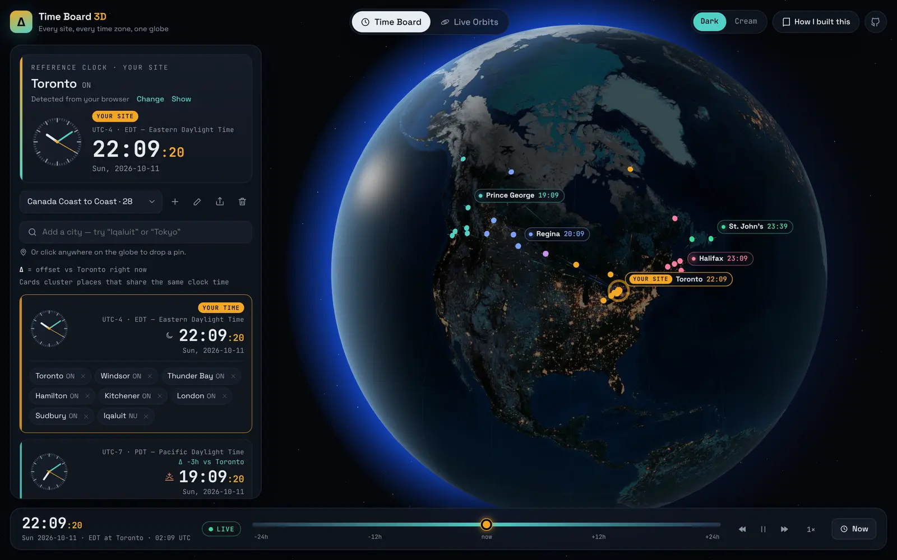
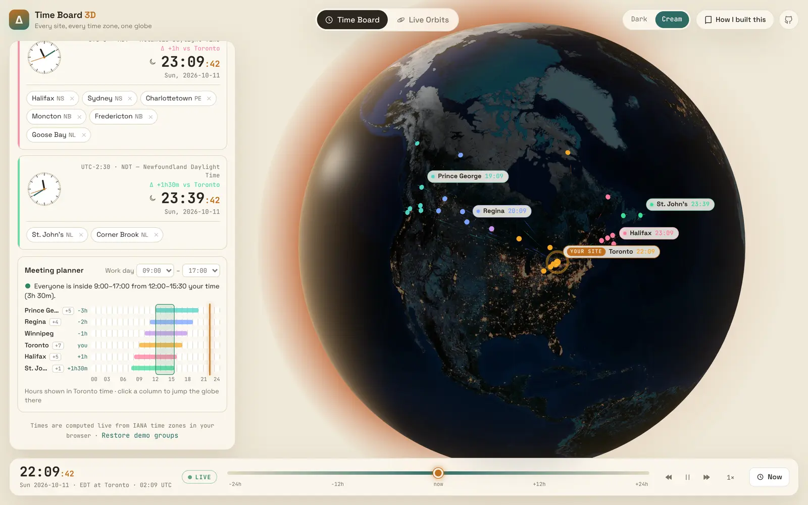
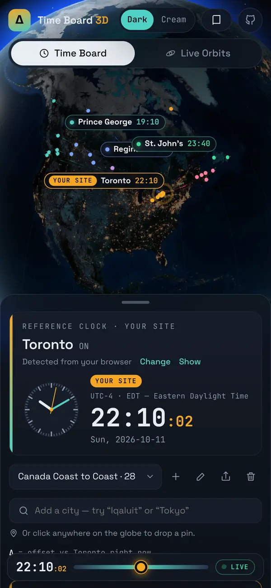

# Time Board · NSOC

**Every site's local time on one board, for the controller who covers them all.**

**[▶ Open the app](https://deven-chandel.github.io/Project-Delta/)** · **[How I built it](https://deven-chandel.github.io/Project-Delta/about.html)**



A controller in a National Operations Centre watches sites across every Canadian time zone. When something is
scheduled, they need to know at a glance what time that is at each site, who is on shift, and how to write it in a
report. This board does that one job:

| | |
|---|---|
| **Timeline board** | One row per clock (sites sharing a time are grouped, as in the original v1 board), on a shared 24-hour axis in NSOC time. Each row has its own local hour ticks, daylight shading, staffed-hours bars and a live *now* line. |
| **Crosshair** | Hover anywhere, or use ← →, and one tooltip lists every clock at that moment with staffed counts. Click to convert that time. |
| **Event converter** | "Event at 14:00 on Oct 14 at <site>" → that moment at every site. It flags times that DST skips or repeats, and lists any site that is unstaffed then. |
| **Copy for reports** | One click copies `14:00 ET / 13:00 CT / 12:00 CST / 12:00 MT / 11:00 MST / 11:00 PT / 15:00 AT / 15:30 NT`, or a multi-line block with site names for email. |
| **Events + countdowns** | Broadcasts, maintenance windows and shift changes with live countdowns, the local time at every site, and staffing at start. Daily events keep their local wall time across DST. |
| **Shift / on-air hours** | Per group or per site. Overnight shifts (22:00–06:00) and 24 h coverage both work, including on 23 h and 25 h DST days. |
| **Your own sites** | Make a group, add sites from 2,360 cities or by clicking the map, and share it by link (hours and events included). Groups are saved in the browser, with JSON backup and import. |
| **NSOC reference** | Chosen once on first visit (suggested from your time zone). Every Δ is measured from it. |
| **Map** | A secondary 3D globe showing where the sites are and where it is daylight, following the crosshair or converted time. |

<p>
  
  
</p>

## How it's built

Plain TypeScript and Vite, with no UI framework and no backend. All time logic lives in `src/core` as pure, unit-tested functions:

- `convert.ts` turns a wall time into an instant and detects when a time is skipped or repeated by DST. It never quietly picks one.
- `shifts.ts` handles staffed windows, including ones that wrap past midnight, and coverage at a given moment.
- `report.ts` and `abbr.ts` build report lines. Overrides cover zones that Intl names badly, such as Whitehorse (MST all year) and Regina (CST all year).
- `rows.ts` is the single row model shared by the timeline, the tooltip, the map and the converter.
- `palette.ts` has eight fixed colours, checked against both themes with a colourblind-safety validator. A ninth group gets grey instead of a new colour.
- `migrate.ts` upgrades saved data from the previous version, and `share.ts` still decodes v1 share links.

```
src/core/   time zones, conversion, shifts, reports, countdowns, palette, storage (pure)
src/ui/     timeline board, converter, events, sites, NSOC dialog (plain DOM)
src/globe/  three.js map: Earth shader with real-time terminator, pins, labels
tests/      48 Vitest tests: DST days, half-hour zones, overnight shifts, date line, migration, share links
```

## Run it locally

```bash
npm install
npm run dev     # http://localhost:5173
npm test        # 48 unit tests
npm run build   # typecheck + production build to dist/
```

## Keyboard

`←` `→` move the crosshair 15 min (Shift: 1 h) · `Enter` convert that time · `N` back to now · `T` theme

## History

1. **v1** was a single HTML file: 28 Canadian places, grouped into cards by UTC offset, with Toronto hard-coded.
2. **v2 ("Time Board 3D")** put the board on a globe and added a live satellite tracker. It looked impressive but didn't serve the controller.
3. **v3 (this version)** removed the satellites (about 2,900 lines) and rebuilt the app around the NSOC workflow.

The [case study](https://deven-chandel.github.io/Project-Delta/about.html) covers each step.

## Credits

Earth imagery: NASA Blue Marble and Black Marble (public domain), via the [three-globe](https://github.com/vasturiano/three-globe)
examples. City index: [city-timezones](https://github.com/kevinroberts/city-timezones) (MIT). Ocean time zones:
[@photostructure/tz-lookup](https://github.com/photostructure/tz-lookup) (CC0). Fonts: Space Grotesk and JetBrains Mono (OFL).
Colour palette: dataviz reference palette, validated for colour-vision deficiency.
